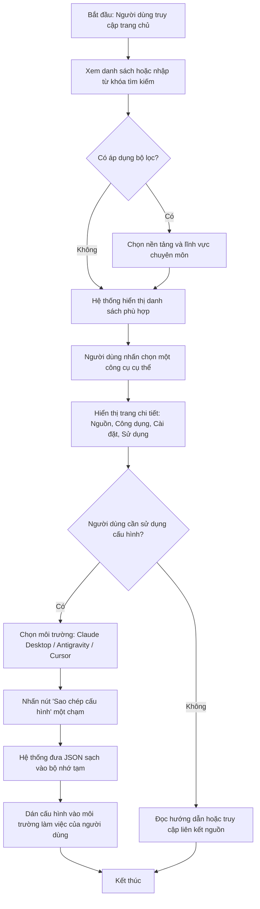
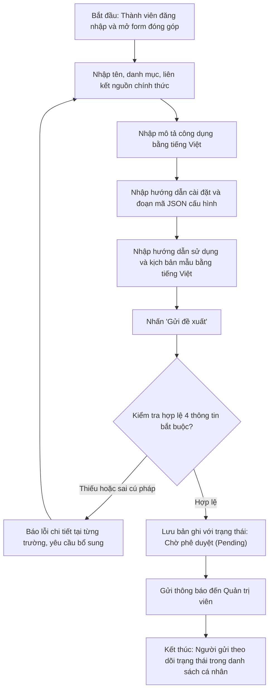
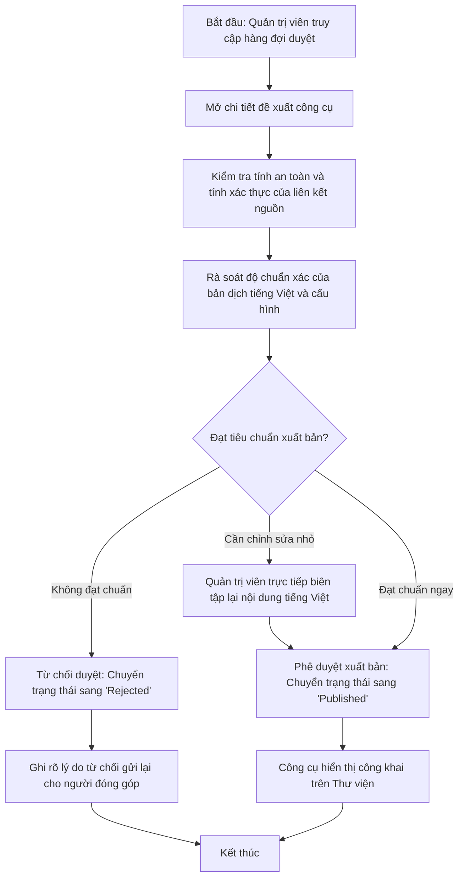
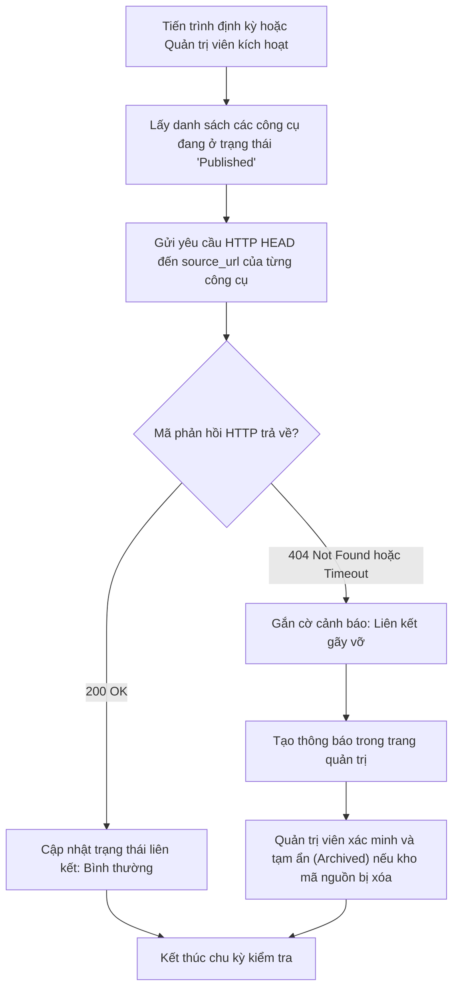

# 06. Luồng Nghiệp Vụ: Hệ Thống Quản Lý Và Tra Cứu Công Cụ Trí Tuệ Nhân Tạo

---

## 1. Mục Đích
Tài liệu này trực quan hóa các quy trình hoạt động chính trong hệ thống thông qua các sơ đồ luồng nghiệp vụ, xác định điều kiện bắt đầu, các bước xử lý, rẽ nhánh điều kiện và kết quả kết thúc.

---

## 2. Luồng Nghiệp Vụ 01: Tra Cứu Và Sao Chép Cấu Hình Công Cụ

---

## 3. Luồng Nghiệp Vụ 02: Đóng Góp Công Cụ Mới Từ Cộng Đồng

---

## 4. Luồng Nghiệp Vụ 03: Kiểm Duyệt Và Xuất Bản Công Cụ

---

## 5. Luồng Nghiệp Vụ 04: Giám Sát Tính Khả Dụng Của Liên Kết Nguồn (Link Health Check)

