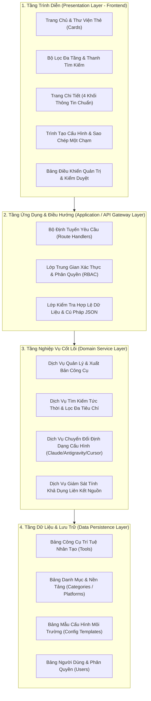

# 09. Kiến Trúc Hệ Thống: Hệ Thống Quản Lý Và Tra Cứu Công Cụ Trí Tuệ Nhân Tạo

---

## 1. Mục Đích
Tài liệu này xác định kiến trúc tổng thể, mô hình phân tầng, nguyên tắc thiết kế kỹ thuật và giải pháp tích hợp cho hệ thống.

---

## 2. Hiện Trạng Triển Khai: Tách Frontend, Backend, Database

Kho mã được chia thành bốn phần độc lập bằng npm workspaces (từ phiên bản 2.2.0). Mỗi phần có `package.json`, gói phụ thuộc và kiểm thử riêng; các phần chỉ phụ thuộc nhau qua tên gói `@aihub/*`.

| Phần | Thư mục / gói | Trách nhiệm | Triển khai |
|---|---|---|---|
| Frontend | `frontend/` (`@aihub/frontend`) | Giao diện React + Vite + Tailwind; đăng nhập và lưu trữ người dùng qua Firebase client; mô phỏng định tuyến MCP ngay trên trình duyệt | Trang tĩnh trên Vercel (`vercel.json`, đầu ra `frontend/dist`) |
| Backend | `backend/` (`@aihub/backend`) | Máy chủ MCP (stdio), Cổng REST API có xác thực khóa, giới hạn tần suất, nhật ký kiểm toán | Tiến trình Node chạy trên máy người dùng hoặc máy chủ (`npm run mcp:stdio`, `npm run mcp:api`) |
| Database | `database/` (`@aihub/database`) | Kho dữ liệu công cụ `data/allTools.json`, điểm truy cập `TOOLS_FILE`/`loadTools()`, quy tắc bảo mật Firestore, script kiểm định và nhập dữ liệu | Tệp dữ liệu nằm trong kho mã; quy tắc Firestore triển khai bằng Firebase CLI từ thư mục `database/` |
| Shared | `shared/` (`@aihub/shared`) | Thuật toán định tuyến (`gateway-core.js`), bộ so khớp ý định, bảng ý định chuyên biệt; không phụ thuộc Node hay trình duyệt | Được frontend đóng gói và backend import |

```mermaid
flowchart LR
    FE["frontend<br/>(React + Vite)"] -->|import lúc chạy| SH["shared<br/>(gateway-core)"]
    FE -.->|chỉ lúc build: đóng gói allTools.json thành tệp tĩnh| DB["database<br/>(allTools.json, firestore.rules)"]
    BE["backend<br/>(MCP stdio + REST API)"] -->|import| SH
    BE -->|loadTools()| DB
    FE -->|Firebase SDK| FS[("Cloud Firestore<br/>(quy tắc: database/firestore.rules)")]
    FE -.->|trang Quản lý API, khi người dùng kết nối| BE
```

Lưu ý về hiện trạng:
- Dữ liệu công cụ được frontend đóng gói thành tệp tĩnh lúc build (`frontend/dev-server/toolDataSplit.js`), nên bản triển khai trên Vercel không cần máy chủ backend.
- Dữ liệu người dùng (đóng góp, ghi đè phân loại, phê duyệt) lưu trong `localStorage` hoặc Cloud Firestore khi bật `VITE_FIRESTORE_ENABLED`.
- Các mục 3 và 4 bên dưới mô tả mô hình phân tầng mục tiêu (cơ sở dữ liệu quan hệ, máy chủ API cho giao diện); các thành phần đó chưa được triển khai.

---

## 3. Mô Hình Phân Tầng Kiến Trúc Tổng Thể

Hệ thống được thiết kế theo mô hình kiến trúc phân tầng hiện đại (Layered Architecture), bảo đảm tính tách biệt mối quan tâm (Separation of Concerns), dễ bảo trì và mở rộng:



---

## 4. Các Phân Hệ Kỹ Thuật Chính

### 4.1. Phân hệ Giao diện người dùng (Frontend Web Application)
- **Kiến trúc phát triển**: Xây dựng theo mô hình kết xuất phía máy chủ kết hợp nạp động phía máy khách (SSR / SSG kết hợp Client Hydration) giúp tối ưu hóa công cụ tìm kiếm (SEO) và tải trang cực nhanh.
- **Quản lý trạng thái (State Management)**: Quản lý trạng thái tìm kiếm, lọc danh mục và môi trường cấu hình tại máy khách bằng phản ứng tức thì (Reactive State).

### 4.2. Phân hệ Giao tiếp ứng dụng (API Layer)
- **Chuẩn giao tiếp**: RESTful API chuẩn hóa, định dạng trao đổi dữ liệu duy nhất bằng JSON.
- **Bảo mật và lọc dữ liệu**: Mọi dữ liệu gửi lên đều đi qua lớp kiểm tra hợp lệ nghiêm ngặt, ngăn chặn các cuộc tấn công tiêm mã (XSS, SQL Injection).

### 4.3. Phân hệ Lưu trữ dữ liệu (Database Layer)
- Lưu trữ có cấu trúc với ràng buộc toàn vẹn khóa chính, khóa ngoại và chỉ mục (Indexing) trên các cột tìm kiếm thường xuyên (`slug`, `name`, `status`, `category_id`).

---

## 5. Nguyên Tắc Kiến Trúc Bắt Buộc

1. **Nguyên tắc "Độc lập dữ liệu cấu hình"**: Các đoạn mã cấu hình JSON của từng nền tảng (Claude Desktop, Antigravity, Cursor) được tách biệt rõ ràng, cho phép cập nhật định dạng cấu hình mới mà không làm thay đổi bảng dữ liệu công cụ chính.
2. **Nguyên tắc "An toàn liên kết nguồn"**: Mọi đường dẫn liên kết ngoài đều được mở trong tab mới với thuộc tính bảo mật `rel="noopener noreferrer"`.
3. **Nguyên tắc "Bảo tồn dữ liệu"**: Sử dụng cơ chế xóa mềm (Soft Delete) hoặc trạng thái tạm ẩn (`Archived`), không xóa vật lý các bản ghi công cụ để đảm bảo tính toàn vẹn và lịch sử truy vết.
