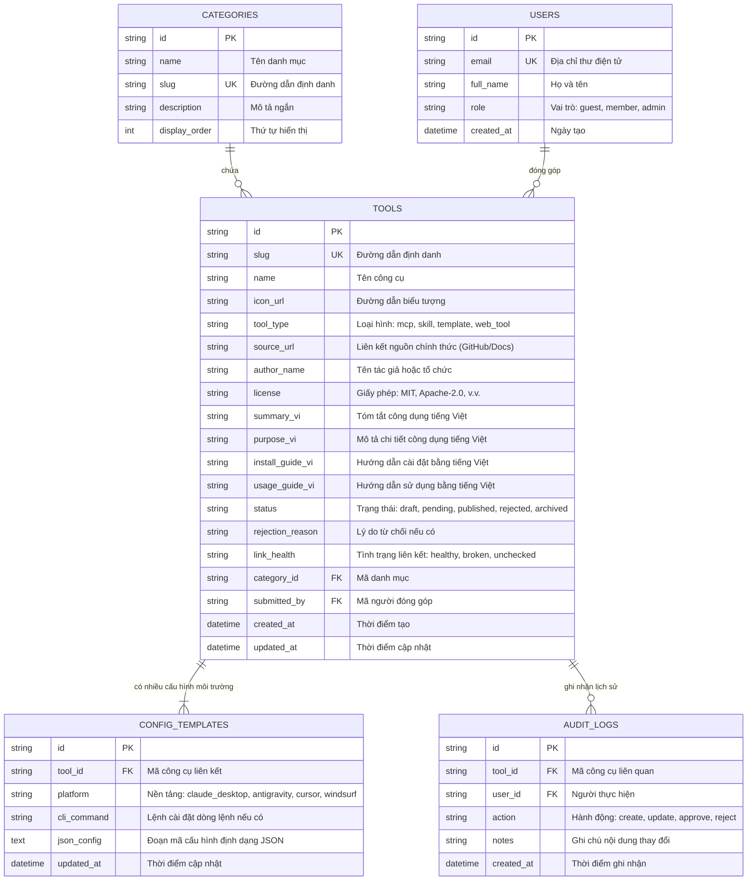

# 13. Cơ Sở Dữ Liệu: Hệ Thống Quản Lý Và Tra Cứu Công Cụ Trí Tuệ Nhân Tạo

---

## 1. Mục Đích
Tài liệu này xác định chi tiết cấu trúc cơ sở dữ liệu quan hệ, danh sách bảng, trường thông tin, kiểu dữ liệu, các ràng buộc toàn vẹn và chỉ mục để phục vụ lưu trữ và truy vấn tối ưu.

---

## 1.1. Hiện Trạng Lưu Trữ Thực Tế (2026-10-23)

Các bảng ở mục 2 và 3 là **thiết kế mục tiêu**, chưa có hệ quản trị cơ sở dữ liệu. Dữ liệu hiện được lưu như sau:

| Dữ liệu | Nơi lưu | Ghi chú |
|---|---|---|
| Kho công cụ (tương ứng bảng `tools`, `config_templates`) | `src/data/allTools.json` (mảng JSON, mỗi phần tử theo kiểu `AITool` trong `src/types/index.ts`) | Nguồn dữ liệu duy nhất. Khi build, các trường `readmeVi`, `installGuideVi`, `usageGuideVi`, `samplePromptsVi` được tách ra `tool-details/<id>.json` (`server/toolDataSplit.js`). |
| Công cụ đóng góp, ghi đè phân loại và phê duyệt, bộ sưu tập, hồ sơ | `localStorage` của từng trình duyệt (`src/lib/storage.ts`) | Không dùng chung giữa người dùng (xem HC-01, HC-02 trong `19_AN_TOAN_BAO_MAT.md`). |
| Khóa API và salt của Cổng REST API | `mcp-gateway/data/` | Không đưa lên kho mã. |

Trường kiểm định trong mỗi bản ghi công cụ (`verification`, sinh bởi `npm run data:validate -- --online --write`):

| Trường | Kiểu | Ý nghĩa |
|---|---|---|
| `checkedAt` | Chuỗi ISO 8601 | Thời điểm kiểm định gần nhất |
| `sourceStatus` | `ok` \| `missing` \| `unknown` | Liên kết nguồn tồn tại / không tồn tại (repo GitHub không đọc được, hoặc trang trả về 404/410) / không kết luận được |
| `missingPackages` | Mảng chuỗi | Gói npm trong câu lệnh cài đặt không tồn tại trên registry |
| `guideIsTemplate` | Boolean | Hướng dẫn cài đặt hoặc sử dụng là nội dung mẫu chung |
| `starsVerified` | Boolean | Số sao đã được lấy từ GitHub API. Giao diện chỉ hiển thị số sao khi giá trị này là `true` |

`linkHealth` được suy ra từ `sourceStatus`: `ok` → `healthy`, `missing` → `broken`, `unknown` → `unchecked`.

## 2. Sơ Đồ Thực Thể Quan Hệ (Entity Relationship Diagram)

---

## 3. Đặc Tả Chi Tiết Các Bảng Dữ Liệu

### 3.1. Bảng `tools` (Quản lý công cụ AI - Bảng cốt lõi)
| Tên Trường | Kiểu Dữ Liệu | Ràng Buộc | Ý Nghĩa / Diễn Giải |
| :--- | :--- | :--- | :--- |
| `id` | `VARCHAR(36)` | Khóa chính (UUID) | Mã định danh duy nhất |
| `slug` | `VARCHAR(120)` | Độc nhất, Không rỗng | Đường dẫn thân thiện trên thanh địa chỉ |
| `name` | `VARCHAR(150)` | Không rỗng | Tên công cụ hoặc máy chủ MCP |
| `icon_url` | `VARCHAR(500)` | Tùy chọn | Đường dẫn ảnh biểu tượng đại diện |
| `tool_type` | `VARCHAR(50)` | Không rỗng | Phân loại: `mcp`, `skill`, `template`, `web_tool` |
| `source_url` | `VARCHAR(500)` | Không rỗng | **Liên kết nguồn chính thức** (GitHub, Docs...) |
| `author_name` | `VARCHAR(100)` | Không rỗng | Tên tác giả hoặc nhóm phát triển |
| `license` | `VARCHAR(50)` | Mặc định 'MIT' | Loại giấy phép sử dụng |
| `summary_vi` | `VARCHAR(255)` | Không rỗng | Tóm tắt công dụng hiển thị trên thẻ |
| `purpose_vi` | `TEXT` | Không rỗng | **Mô tả công dụng và tính năng chi tiết bằng tiếng Việt** |
| `install_guide_vi` | `TEXT` | Không rỗng | **Hướng dẫn cài đặt chi tiết bằng tiếng Việt** |
| `usage_guide_vi` | `TEXT` | Không rỗng | **Hướng dẫn sử dụng và câu lệnh mẫu bằng tiếng Việt** |
| `status` | `VARCHAR(30)` | Không rỗng | Trạng thái: `draft`, `pending`, `published`, `rejected`, `archived` |
| `rejection_reason`| `TEXT` | Tùy chọn | Lý do từ chối kiểm duyệt nếu có |
| `link_health` | `VARCHAR(30)` | Mặc định 'unchecked'| Trạng thái liên kết: `healthy`, `broken`, `unchecked` |
| `category_id` | `VARCHAR(36)` | Khóa ngoại | Tham chiếu đến bảng `categories` |
| `submitted_by` | `VARCHAR(36)` | Khóa ngoại | Tham chiếu đến bảng `users` |
| `created_at` | `DATETIME` | Mặc định NOW() | Thời điểm tạo |
| `updated_at` | `DATETIME` | Mặc định NOW() | Thời điểm cập nhật cuối cùng |

### 3.2. Bảng `config_templates` (Mẫu cấu hình môi trường)
| Tên Trường | Kiểu Dữ Liệu | Ràng Buộc | Ý Nghĩa / Diễn Giải |
| :--- | :--- | :--- | :--- |
| `id` | `VARCHAR(36)` | Khóa chính (UUID) | Mã định danh mẫu cấu hình |
| `tool_id` | `VARCHAR(36)` | Khóa ngoại, Không rỗng | Tham chiếu đến bảng `tools` |
| `platform` | `VARCHAR(50)` | Không rỗng | Môi trường: `claude_desktop`, `antigravity`, `cursor` |
| `cli_command` | `VARCHAR(500)` | Tùy chọn | Câu lệnh cài đặt nhanh qua dòng lệnh (`npx`, `uvx`...) |
| `json_config` | `TEXT` | Không rỗng | Đoạn mã cấu hình JSON chuẩn hóa |
| `updated_at` | `DATETIME` | Mặc định NOW() | Thời điểm cập nhật |

### 3.3. Bảng `categories` (Danh mục phân loại)
| Tên Trường | Kiểu Dữ Liệu | Ràng Buộc | Ý Nghĩa / Diễn Giải |
| :--- | :--- | :--- | :--- |
| `id` | `VARCHAR(36)` | Khóa chính (UUID) | Mã định danh danh mục |
| `name` | `VARCHAR(100)` | Không rỗng | Tên tiếng Việt của danh mục |
| `slug` | `VARCHAR(100)` | Độc nhất, Không rỗng | Đường dẫn thân thiện danh mục |
| `description` | `VARCHAR(255)` | Tùy chọn | Mô tả phạm vi ứng dụng của danh mục |
| `display_order`| `INT` | Mặc định 0 | Thứ tự hiển thị ưu tiên trên thanh lọc |

---

## 4. Ràng Buộc Toàn Vẹn Và Chỉ Mục Tối Ưu (Indexes)

1. **Ràng buộc kiểm tra tính toàn vẹn 4 khối thông tin**:
   - `CONSTRAINT chk_tool_mandatory_fields CHECK (status != 'published' OR (source_url IS NOT NULL AND purpose_vi IS NOT NULL AND install_guide_vi IS NOT NULL AND usage_guide_vi IS NOT NULL))`
2. **Chỉ mục tăng tốc tìm kiếm**:
   - `CREATE INDEX idx_tools_status_category ON tools(status, category_id);`
   - `CREATE INDEX idx_tools_slug ON tools(slug);`
   - `CREATE INDEX idx_config_tool_platform ON config_templates(tool_id, platform);`
